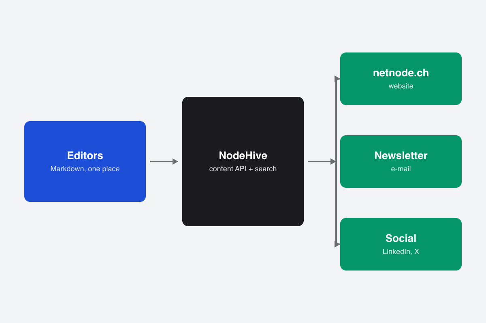
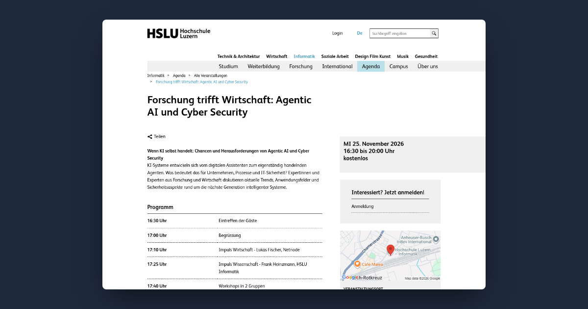

# Ich heisse Lukas......

Editors write once

asdfasdf

asdfasldfjöl

::subtitle::
Content pipeline review · November 2026
asdf

::image::


::notes::
Open with the migration timeline: editors first, channels second. Keep this slide under 30 seconds.

---
layout: content
slots:
  cards1:
    kind: html
    x: 0.44
    y: 1.71
    w: 9.12
    h: 2.2
    size: 15
---
# New slide

-

::cards1::
<div class="kpis"><div class="kpi"><strong>120</strong><span>pages</span></div><div class="kpi"><strong>5 min</strong><span>to publish</span></div><div class="kpi"><strong>-60%</strong><span>time per text</span></div></div>

---
layout: section
---
# Where we stand

::subtitle::
asdfPart 1

---
layout: image
---
# Three problems with the old setup

- **Five editors, four tools**: every text is copied by hand into the website, the newsletter and LinkedIn
- Nobody knows which version is live; the newsletter went out with last month's price twice
- A new channel means a new workflow, `~3 weeks` each time
- asdfasf

::notes::
Ask the room: who copied a text by hand this week?

---
layout: image
---
# Three problems with the old setup.

- **Five editors, four tools**: every text is copied by hand into the website, the newsletter and LinkedIn
- Nobody knows which version is live; the newsletter went out with last month's price twice
- A new channel means a new workflow, `~3 weeks` each time

::notes::
Ask the room: who copied a text by hand this week?

---
layout: two-column
slots:
  table1:
    kind: table
    x: 1.79
    y: 3.2
    w: 6
    h: 1.6
    size: 14
    color: muted
---
# New slide...

-

::table1::
| Item | Value |
|---|---|
| First | 1 |
| Second | 2 |

---
layout: section
slots:
  subtitle:
    color: accent
  title:
    x: 0.44
    y: 2.3
---
# One source, every channel

asdffasdf

::left::
1. Editors write **once**, in markdown
2. NodeHive stores it with its history
3. Every channel pulls from the same API
4. Agents draft, humans approve

::right::


---
layout: chart
slots:
  chart:
    font: Futura
---
# Time per text, before and after

::chart::
```chart
kind: column
title: Minutes per published text
categories: [Write, Review, Publish, Fix]
series:
  - name: Today
    values: [45, 30, 40, 25]
  - name: With NodeHive
    values: [45, 20, 5, 5]
```

::caption::
Measured on 12 texts in October; publishing drops from 40 to 5 minutes.

---
layout: table
---
# What it costs

| Item | One-off | Per month |
|---|---|---|
| Migration of 120 pages | CHF 9'600 | — |
| NodeHive hosting | — | CHF 290 |
| Editor training (2 × ½ day) | CHF 1'800 | — |
| **Total first year** | **CHF 11'400** | **CHF 290** |

---
layout: table
---
# What it costs

| Item | One-off | Per month |
|---|---|---|
| Migration of 120 pages | CHF 9'600 | — |
| NodeHive hosting | — | CHF 290 |
| Editor training (2 × ½ day) | CHF 1'800 | — |
| **Total first year** | **CHF 11'400** | **CHF 290** |

---
layout: quote
---
::quote::
We stopped copying and started publishing.

::attribution::
Head of Communications, pilot customer

---
layout: content
slots:
  body:
    color: text
    x: 0.44
    y: 1.19
    w: 9.12
    h: 3.95
    font: Avenir Next
  title:
    font: Avenir Next
    bold: false
    italic: true
    align: center
    x: 0.44
    y: 0.28
    w: 9.12
    h: 0.8
---
# Decision today

- Start the migration on **1 December**, website first
- Newsletter and LinkedIn follow in January
- Review in February with the same twelve texts
- This ist
<br><br><br><br>

<div class="callout">Go/no-go needs one decision today.</div>

::eyebrow::
This is a label

---
slots:
  image1:
    kind: image
    x: 3.7
    y: 1.02
    w: 5.69
    h: 3.58
  body:
    x: 0.44
    y: 1.32
    w: 3.03
    h: 3.59
---
<div class="callout">Go/no-go needs one decision today.</div>

::image1::


::notes::
End on the decision. If there is no decision, ask what is missing.
